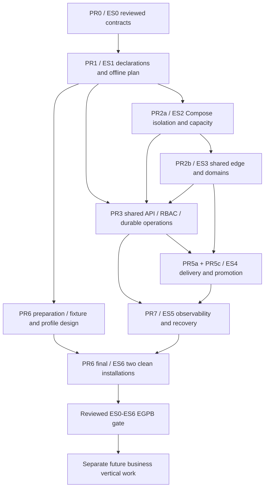

# Engineering slices: dependency and acceptance matrix

Status: proposed execution gates under the sole [master roadmap](../../superpowers/plans/2026-10-28-bsk-agent-master-plan.md).
No ES1–ES6 acceptance is claimed by this PR. Use synthetic HTTP/version/counter
fixtures only. Business verticals remain blocked until all ES0–ES6 evidence is
reviewed. Each PR must be independently reviewable; PR numbers describe backlog
stages, not the order in which independent optional work must ship.

## Dependency graph

PR2a/PR2b split the master plan's PR2 along runtime and shared-edge review
boundaries. PR3 follows those first local drivers; PR5b Jenkins is optional.
PR2 owns its persistent local inventory/claims adapter and concurrency tests;
PR3 extends that state boundary with durable authenticated operations. PR2 must
not depend on a queue or registry that exists only in PR3.
PR6 fixture preparation may precede PR7, but ES6 completion must follow ES5.
PR4/ES7 bootstrap/private control and PR8+ portability are not prerequisites for
the local EGPB. This avoids a PR6/PR7 numbering dependency inversion.

## Acceptance matrix

| Slice / dependencies | Smallest behavior and implementation boundary | Positive acceptance | Required negative/failure cases | Evidence required before claiming completion |
|---|---|---|---|---|
| ES0 / existing ADRs and actual source | Audit, semantic contracts, threats, ADR proposals, next scoped plan | Source-linked status matrix and actual baseline commands | Discrepancies and blocked/skipped checks explicitly reported | This package, reviewer findings, test-results record; architecture approval remains separate |
| ES1 / accepted ES0 | Project/Environment/Service JSON schemas, scope validator, deterministic dry-run CLI; no daemon/API | Two projects with 1, 5 and 10 arbitrary env names **each**; same names across projects allowed; byte-stable plan after resource/object-key reorder; explicit policies/runtimes | Duplicate keys/route claims, cross-project or unknown refs, malformed/version/unknown fields, slug traversal, unsafe route, bad numeric resources, non-JSON, size/count overflow; apply/down/destroy commands rejected | Linux/Windows Node 20 contract tests plus CLI exit/stdout/stderr, before/after filesystem snapshot; process/network hooks deny external effects |
| ES2 / ES1 | First opt-in Compose driver, scoped inventory, resource admission; disposable Linux host | Two projects with own networks/volumes/secret refs; observe CPU/memory/PID values; synthetic load demonstrates throttling/OOM behavior; stop A preserves B and A data | Foreign/unlabeled destroy denied; database unreachable from B/public interface; capacity exceeds reserves, rollout overlap, storage enforce unsupported, privileged mounts rejected; daemon unavailable reports failure | Pinned Engine/Compose/Linux/cgroup versions, redacted generated config, inspect/cgroup records, denied connectivity results, volume markers/checksums before/after; no runtime skips counted as pass |
| ES3 / ES2 | Installation-owned edge plus persistent route claims, generator, guarded reload; Caddy first | Three projects, six `.test` hostnames, `/` and nested paths, one 80/443 listener, public HTTP probes and correct strip semantics | Cross-owner hostname/nested capture, duplicate route, invalid host/port/path, direct upstream SSRF, spoofed identity, private route leakage, invalid reload and concurrent route updates | Route registry generations, candidate validation, last-known-good restoration and unaffected-route probes; no public DNS/ACME; inspect proves edge not on DB networks |
| Shared execution prerequisite / ES1–ES3 (PR3) | Common application service, auth/RBAC, durable operation/idempotency, worker leases and observed status; minimal UI consumes API | CLI/API submit equivalent typed plan/operation, see same actual outcome and correlation/audit | Foreign reads/writes denied, expired/stale plans/approvals, replay conflict, duplicate/racing operations, worker crash between apply and persist, cancellation after mutation, public privileged access | OpenAPI/contract tests, transaction/lease failure tests, redacted audit, real driver observed state; UI tests if UI ships. No mock-only success |
| ES4 / ES3 + PR3 | Project-scoped GitHub Actions → OCI registry → release/promotion → operation; PR5a and PR5c | A build emits digest D; same D promoted through two disposable environments with no rebuild; independent B pipeline; approval recorded where policy requires | A's identity/secrets cannot deploy/read B; missing approval, unknown env, invalid/mutable digest, forged/replayed webhook, untrusted artifact, pull failure; serialize same env, cap concurrent builds | Run IDs/source commits/test outcomes and skips, SBOM/provenance policy results, registry digest and observed container digest, scoped denial/audit, rollback boundary evidence. Jenkins equivalence later PR5b |
| ES5 / ES4 + PR3 | Telemetry ports/runtime instrumentation, failure status and artifact/config rollback, disposable data and control-plane restore (PR7) | Operation→deployment→request correlation, redacted logs, failure alert/status, safe previous-artifact restoration; restored counter/data matches checksum | Bad gateway, failed readiness, interrupted deployment/reconciler restart, simulated private transport outage, backend telemetry outage, corrupt/interrupted backup, incompatible migration prevents automatic revert | Trace IDs/events and redaction assertions, before/after digest and checksums, isolated restore logs, measured RPO/RTO for fixture, runbook followed by clean operator. Corrupt restore is a failed check, not backup success |
| ES6 / ES1–ES5 incl. PR3 | Versioned fixture/profile generation and full shared CLI/API Golden Path, final PR6 gate | Two clean installations each run define→validate→plan→build→deploy→verify→update→rollback→down→authorized teardown; second independent generic service needs no bespoke networking/pipeline copy | Optional providers disabled, unknown capabilities denied, failed readiness/update, private transport unavailable, teardown foreign ownership, stale observed state; no undocumented manual steps | Two fresh-host/clone identities, profile/tool versions, reproducible commands, immutable digest lineage, negative results, post-teardown inventory and retained data policy; reviewer signs aggregate ES0–ES6 evidence |

## Conformance harness and implementation rules

ES3 also owns [ADR 0008's certificate lifecycle acceptance](../decisions/0008-shared-gateway-and-route-ownership.md):
separate ingress activation from certificate issuance/renewal, test challenge
ownership/cleanup, renewal success/no-op/failure, expiry, secret protection and
bad-certificate/reload rollback using local fixtures. Caddy is the first ingress
target; optional Nginx/Certbot and future optional Traefik require separate
adapter evidence. No certificate implementation or schema is added to PR1.

PR1 can use existing Node test runner and locked Ajv; no runtime provider is
required. ES2+ needs a dedicated opt-in disposable-host job, clearly separated
from current config-only CI. Pin a supported Linux Engine/Compose/cgroup matrix
when implementing it and publish actual versions. Do not use the developer's
active Docker host for destructive tests by default. Create a unique fixture
installation, verify its identity before teardown and delete only owned targets.

Persist each run's commit, commands, tool versions, passed/failed/blocked/skipped
checks, redacted logs and runtime observations. Keep negative tests alongside
their owning implementation, not as documentation assertions. Require review
of access, secrets, supply chain, compatibility and licensing before remote use.
Failure to run a required runtime check leaves that slice unproven even when all
unit tests pass. Do not make Jenkins, Tailscale, Cloudflare, Kubernetes, n8n,
Supabase, cloud accounts or a business product necessary to pass local EGPB.

## Reviewable implementation sequence and stop conditions

1. Review PR0 proposals and explicit compatibility gaps; do not accept GA claims.
2. PR1/ES1 only: implement the [bounded proposal](../../superpowers/plans/2026-10-29-bsk-pr1-es1-proposal.md).
3. PR2a/ES2: local Compose ownership, limits and lifecycle; stop for runtime/security review.
4. PR2b/ES3: shared edge registry and rollback; stop for routing review.
5. PR3: shared authenticated execution and durable observed operations; stop for auth/recovery review.
6. PR5a then PR5c: OCI lineage then promotion/policy; separate optional Jenkins PR5b.
7. PR7/ES5: correlated failure and restore; finalize PR6/ES6 only after it passes.
8. Review EGPB evidence before authorizing a separately scoped business vertical.

Bootstrap ES7 and portability ES8 remain separate later work with their own
authorization. This PR stops at step 1's review package and does not execute
any of the implementation steps above.
