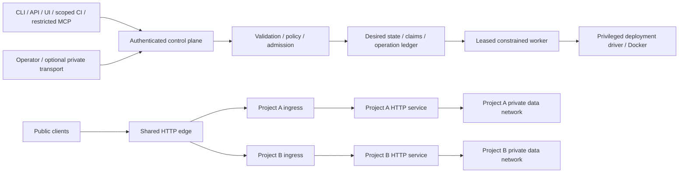

# ES0 threat model and staged controls

Status: proposed architecture, not implemented mitigation. Scope: one installation
with several cooperating projects on a disposable Linux Compose host. Host root,
Docker daemon and the constrained worker are privileged trust anchors. Compose
names/networks are not a security boundary against hostile host administrators or
kernel exploits; use stronger host/VM isolation for untrusted workloads.

Assets: project ownership, release integrity, runtime availability, persistent
data, secrets, route/certificate ownership, resource capacity and audit evidence.
Actors: project developer, operator, CI identity, read-only automation/AI,
untrusted public client, compromised app/build and privileged worker. A project
developer is not implicitly an installation operator.

## Intended boundaries

The diagram is the proposed target. The current source has a global shared edge
network and no authenticated control plane. The gateway must not attach to data
networks; app containers cannot control it. Private transport grants reachability
only, not project privileges. All clients share server-side authorization before
execution; an offline ES1 plan makes no authorization claim.

## Abuse cases and acceptance ownership

| Boundary / threat | Current evidence or gap | Required control / negative proof | Stage |
|---|---|---|---|
| Untrusted declarations → planner: path/shell injection, unknown fields | No canonical planner; legacy deployment shell interpolation | Closed schemas, strict slugs, reject shell/metacharacters/paths, bounded input; no process/network/filesystem mutation during plan | ES1 |
| Project identity → resource graph: confused deputy | No project graph or membership implementation | Every ref checked against installation/project/environment; duplicate names denied in scope; same name allowed in distinct projects; authenticate owner binding before persistence | ES1 structural; PR3 auth |
| CLI/API/CI/MCP → control plane: privilege escalation | Packages are placeholders | Deny-by-default RBAC, per-target approval, no arbitrary exec endpoint; read-only AI default; reject foreign read/write with no metadata leak | PR3, ES4 |
| Plan → apply: stale policy/capacity and concurrent claims | No leases, queue or transactional ledger | Bind plan generation/policy/actor/expiry, reserve capacity/routes transactionally, serialize environment/gateway mutation; replay and race tests | PR2/PR3 |
| Build runner → release: malicious code/artifact | Existing mutable builds/tags, no provenance gate | Isolated runner, scoped credentials, digest/provenance verification; A cannot deploy B, invalid digest/webhook/replay/approval denied | ES4 |
| Driver → host: arbitrary shell/socket/bind mounts | Docker is privileged; legacy scripts shell-based | Allowlisted typed actions, argument-safe invocation, no public Docker socket, approved host identity, deny privileged/host mounts/network | ES2/PR3/ES4 |
| App A → B data: lateral access | Global ingress network; no auth enforcement | Per-owner ingress/private networks, no published DB ports; connect-to-foreign-store test denied; never infer auth from a Docker label | ES2 |
| Gateway → private/admin: SSRF and route capture | Fixed Caddy routes, no registry | Owned upstream references, host ownership, conflict/path validation, private listener tests, no raw URL/config; no admin on public edge | ES3 |
| Client → identity headers: spoofed IP | Copies `CF-Connecting-IP` with no established origin trust | Strip untrusted headers, verify trusted proxy hop and direct-origin behavior; auth uses verified principal | ES3/PR4 |
| Tenant → host capacity: CPU/memory/log/build exhaustion | No effective runtime limits | Admission with reserves and overlap, cgroup inspection, bounded logs/jobs/PIDs; unsupported storage enforce denied, not silently advisory | ES2/ES4/ES5 |
| Lifecycle → data: foreign teardown | Environment-only naming; no guarded destroy | Inventory plus actual ownership labels, separate down/destroy permission, preserve volumes by default; reject unlabeled/foreign resource deletion | ES2/PR3 |
| Worker crash → state: false success or repeated side effects | No reconciler | Durable idempotency/lease/attempt records, observed digest/readiness, bounded retries, reconcile interrupted mutations and terminal status | PR3/ES5 |
| Logs/backups → secrets or cross-project reads | No redaction/retention/read controls; env validator can print values | Opaque SecretRef, redacted diagnostics/events, scoped access/retention, inject fake secret and assert absent in output | ES1/PR3/ES5 |
| Private transport → admin: lockout/public fallback | Tailscale README only | Optional adapter, least-privilege grants, preflight recovery, outage/revocation simulation; public admin stays closed | ES5 simulation; PR4/ES7 adapter |
| Backup → recovery: corrupt or untrusted archive | No demonstrated restore | Dedicated disposable restore target, integrity checks, interrupted/corrupt backup fails visibly; never overwrite production to test | ES5 |
| Repo/logs/webhooks → automation: prompt injection | External text cannot grant authority | Treat content as data, scope tools to typed operations and explicit approvals; instructions in a fixture/log cannot trigger infrastructure access | Cross-cutting |

## Security gates and residual risk

Before a driver handles remote workloads, review trust pinning, credentials,
ownership, command input and failure recovery. Local conformance is not permission
to mutate VPS, DNS, Cloudflare or a Tailnet. No real domains, accounts, customer
data or secrets are used as fixtures. Do not run legacy operational scripts as
part of read-only validation.

Enforce bounded request bytes/resource counts/timeouts in the future CLI/API;
huge hostile input is a resource risk even with valid field patterns. PR1's
proposed bound is 1 MiB per bundle and 1,000 resources/route claims per bundle.
Limits are explicit validation errors, not a maximum of ten environments.

Outstanding risk: all controls above remain planned except existing metadata
guardrails and narrow safety tests. Dependency advisories, shared-kernel risk,
legacy network exposure and missing runtime/API security are unresolved. A green
baseline does not certify production isolation, compliance or reliability.
